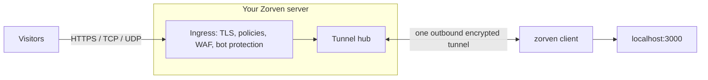

# Zorven

**Zorven publishes a service running on your computer or server at a secure public HTTPS address with one command.** It is a self-hostable, open-source alternative to ngrok and Cloudflare Tunnel, with a built-in security layer, private networking and remote access.

[](https://www.gnu.org/licenses/agpl-3.0)
[](https://go.dev)

No port forwarding, no static IP, no firewall changes: the client only makes an
outbound connection, so it works behind CGNAT, home routers and corporate firewalls.

## 30-second example

```bash
# 1. Install the client (from your Zorven server)
curl -fsSL https://<your-server>/install.sh | sudo bash

# 2. Save your token once (create it in the dashboard)
zorven authtoken zrv_live_...

# 3. Publish the app running on port 3000
zorven 3000
```

The client prints the public address, for example:

```text
Forwarding  https://myapp--acme.yourdomain.com  ->  http://localhost:3000
```

Other shapes of the same idea:

```bash
# Raw TCP (database, game server, SSH): define a TCP tunnel in the dashboard, then
zorven --local localhost:25565
# Share a port privately with one person, end-to-end encrypted (no public address)
zorven share 5432 --to ali@company.com --name db     # recipient: zorven access db --local 5432
```

A temporary tunnel that removes itself: `zorven ephemeral 3000`.

## How it works



The client dials the server (`wss://<server>/_tunnel/v1/connect`), authenticates with
a token and keeps one multiplexed connection open. The server terminates public TLS,
maps the hostname to a tunnel, applies your security rules, and sends the request down
that connection to your local service. Because the connection is always opened from
the inside, nothing needs to be forwarded or opened on your router or firewall.

## What you can use it for

- **Demo and preview URLs.** Show a work-in-progress app to a client with a real HTTPS link.
- **Webhook testing.** Receive Stripe, GitHub or Slack callbacks on your laptop, inspect and replay them, and drop forged ones with signature verification.
- **Self-hosting from home.** Serve a site or API from a machine behind CGNAT or a dynamic IP, on your own domain.
- **Remote support.** Open a browser terminal or share a screen (with file transfer) on a machine you are helping.
- **Team private network.** Give colleagues access to a database or internal service without exposing it to the internet (`zorven share`, `zorven connect`, Zorven Net).
- **MCP servers and AI agents.** Publish your own MCP server, or run `zorven mcp` so an AI assistant gets controlled access to your tunnels.
- **Protecting a public app.** Put a WAF, bot protection, rate limits, geo rules and CAPTCHA in front of an app that has none.
- **Game servers and raw ports.** Reserved TCP/UDP ports and SNI passthrough for non-HTTP traffic.

## Features

**Tunneling**
- HTTP, WebSocket and SSE with streaming bodies; raw TCP and UDP tunnels; SNI-based TLS passthrough on :443
- Automatic hostnames and custom domains with ACME TLS and authoritative DNS verification
- Path-based routing, load balancing with health checks, ephemeral tunnels

**Security at the edge**
- Policy engine (deny, redirect, set header, rate limit, require mTLS) with path, method, geo and IP-list conditions
- Visitor login (Basic, Google, GitHub) with branded sign-in pages; per-tunnel IP allow-lists
- WAF (OWASP-lite rules, log or block), country (Geo) rules from a local database
- Bot protection (challenge page, TLS fingerprint scoring, verified-bot allowlist) and per-tunnel rate limiting
- Zorven CAPTCHA: an embeddable, Turnstile-style widget with proof-of-work and a compatible `siteverify`
- Mutual TLS, webhook signature verification (GitHub, Stripe, GitLab, Shopify, Slack), Secret Vault (AES-256-GCM)
- Web door: visitors sign in on a web page to temporarily unlock a raw TCP/UDP port

**Private network (Zorven Net)**
- WireGuard-based port sharing with chosen users, groups or devices (`zorven share` / `zorven access`)
- Direct peer-to-peer paths (STUN and hole punching) with relay fallback
- Full network layer (OS TUN device: `zorven net up`), SOCKS5 gateway (`zorven connect`), `zorven forward`

**Remote access**
- Browser terminal (PTY) and screen sharing with multi-viewer sessions, H.264 video mode, clipboard and file transfer
- Off by default; enabled per client with `--enable-terminal` / `--enable-screen`

**AI / MCP**
- MCP server (remote endpoint and `zorven mcp` over stdio), OAuth 2.1 for custom connectors, per-tunnel MCP mode with keys and call log

**Observability**
- Live request log, request inspector with replay and replay diff, per-tunnel and TCP/UDP metrics
- Rejected-request log with reasons, access statistics, error-rate alerts, abuse reports

**Teams and mail**
- Organizations, projects, members, e-mail invitations, scoped API tokens
- Self-hosted webmail (inbound and outbound, DKIM/SPF/DMARC) plus IMAP/SMTP access for Gmail, Outlook, Apple Mail and Thunderbird

**Clients**
- CLI with background service, self-update and an interactive `zorven settings` screen; desktop app (Windows, macOS, Linux)
- Dashboard in English and Turkish; REST API with OpenAPI spec; SDKs for Go, Node.js and Python (`sdk/`)

## Self-host in 5 minutes

You need a VPS with a public IP, a domain, and Docker with the Compose plugin.

**1. DNS.** Point two A records at the server: `yourdomain.com` and `*.yourdomain.com`.
For webmail also add an MX record for `mail.yourdomain.com` plus SPF, DKIM and DMARC TXT records.

**2. Ports.** Open 80 and 443. Optional: 25 (inbound mail), 993/587/465 (mail apps),
10000-10099 TCP and UDP (reserved ports for raw tunnels), 3478/udp (STUN for direct P2P).

**3. Configure and start.**

```bash
git clone https://github.com/tkodcumpeg4/zorven.git
cd zorven/deploy
cp .env.example .env     # set PLATFORM_DOMAIN, ADMIN_KEY, ACME_EMAIL,
                         # POSTGRES_PASSWORD, BETTER_AUTH_SECRET (openssl rand -hex 32)
mkdir -p certs           # bootstrap certificate; ACME takes over for real domains
openssl req -x509 -newkey rsa:2048 -nodes -days 365 -subj "/CN=yourdomain.com" \
  -keyout certs/server.key -out certs/server.crt
docker compose up -d
```

**4. First account and first tunnel.** Open `https://panel.yourdomain.com`, sign up (each new
account gets its own organization), create a client token in the dashboard, then connect a client.
Platform administration (the Platform page, all tenants) uses the `ADMIN_KEY` from your `.env`:

```bash
zorven authtoken zrv_live_... && zorven config set-server yourdomain.com:443
zorven 3000
```

Optional settings (Secret Vault key `ZORVEN_SECRET_KEY`, OAuth logins, Geo database via
`scripts/geo-update.sh`, IP lists) are documented inline in
[deploy/.env.example](deploy/.env.example). Back up the database with `deploy/backup.sh`.
Protocol and transport details: [docs/protokol-uyumluluk.md](docs/protokol-uyumluluk.md),
[docs/zorven-network-transport.md](docs/zorven-network-transport.md).

## Clients

```bash
# Linux / macOS
curl -fsSL https://<your-server>/install.sh | sudo bash
```

```powershell
# Windows (PowerShell)
irm https://<your-server>/install.ps1 | iex
```

Handy commands: `zorven status`, `zorven up` (run as a background service, start at boot),
`zorven update`, `zorven settings`. The desktop app (Wails) lives in `desktop/` and offers
the same tunnels, private network and remote access with a graphical interface.
Build the client yourself with `cd client && go build -o zorven .`

## Comparison

| | Zorven | ngrok | Cloudflare Tunnel | Tailscale |
|---|---|---|---|---|
| Self-hostable server | Yes | No | No | - |
| Server and clients open source | Yes (AGPLv3) | - | - | - |
| Custom domains | Yes | Yes | Yes | - |
| Raw TCP / UDP tunnels | Yes | - | - | - |
| Private network between devices | Yes | - | - | Yes |
| WAF / bot protection | Built in | - | Yes (Cloudflare edge) | - |
| Remote terminal / screen sharing | Yes | - | - | - |

Competitor cells are a conservative summary and change over time; check their docs.
A dash means we are not claiming anything for that cell (not offered, or not verified).

## Build from source

Zorven is a Go workspace (`go.work`) with a Nuxt dashboard and SDKs under `sdk/`.

```bash
cd server && go build ./...
cd ../client && go build -o zorven .
cd ../web && npm install && cd .. && bash scripts/build-dashboard.sh   # runs `nuxt generate` and embeds the result in server/webdist
```

| Path | What |
|------|------|
| `server/` | Tunnel server, ingress proxy, policy/WAF engine, HTTP API, webmail, Postgres store |
| `client/` | CLI tunnel agent (`zorven`) |
| `desktop/` | Desktop app (Wails) |
| `shared/` | Wire protocol shared by client and server |
| `sdk/` | Go, Node.js and Python SDKs |
| `web/` | Nuxt dashboard (embedded into the server) |
| `deploy/` | Docker Compose self-hosting stack |

## Open core

This repository contains the complete tunneling product under the **AGPL-3.0**: server,
clients, SDKs, dashboard, webmail and remote access, fully functional and unlimited for
self-hosting, with no feature gates or quotas. See [docs/OPEN-CORE.md](docs/OPEN-CORE.md)
for the exact split.

## Enterprise

Running Zorven as a paid, multi-tenant service needs a few extras that are
distributed separately under a commercial license and are **not** part of this
repository:

- Billing, plan and subscription enforcement (including trials and add-on requests)
- Multi-node high availability (clustering)
- OIDC single sign-on (SSO)
- Audit log
- Log export to external systems (SIEM sinks)
- Zero-trust access conditions (2FA and source-network conditions)
- Service accounts (machine identities)
- Plan-based log retention
- Per-plan short-name quota and suspension of names after a plan downgrade
- Device tags (metadata labels on devices)
- Enterprise identity: per-tenant OIDC/SAML identity provider, group-to-role mapping, enforced SSO, IdP sign-in for tunnel visitors
- Tenant certificate authority and device client certificates (device mTLS, signed device posture)
- Device posture conditions, time-window policies and mid-session re-evaluation; policy-derived private network access control and its access log
- Suspicious-email tracking (disposable-domain and random-looking address detection with a risk score) and periodic email re-verification
- Platform user list (platform console Users tab with risk badges, filters, CSV export and forced re-verification)
- Platform plan management (changing a tenant's plan; plan labels in the platform console)
- Zorven Apps (deploying Docker apps to your own machine through the client)
- Hosted marketing site and billing screens

The core defines the integration seams as interfaces; without the commercial
layer everything runs unlimited on a single node.

## Third-party data

Country-level geolocation (tunnel Geo rules) reads a local MMDB file; no IP is
sent to any third party. Fetch it with `scripts/geo-update.sh`, which downloads
the free DB-IP Lite Country database (a monthly cron is enough).

IP Geolocation by DB-IP (https://db-ip.com), licensed under CC BY 4.0.

## Contributing

Issues and pull requests are welcome. By contributing you agree that your
contributions are licensed under the AGPL-3.0. Please open an issue to discuss
substantial changes before starting.

## Security

Please report vulnerabilities privately; see [SECURITY.md](SECURITY.md).

## License

Copyright (C) 2026 the Zorven authors.

This program is free software: you can redistribute it and/or modify it under
the terms of the **GNU Affero General Public License, version 3**, as published
by the Free Software Foundation. See [LICENSE](LICENSE) for the full text.

The AGPL requires that if you run a modified version of Zorven as a network
service, you must make the corresponding source of your modified version
available to its users.
